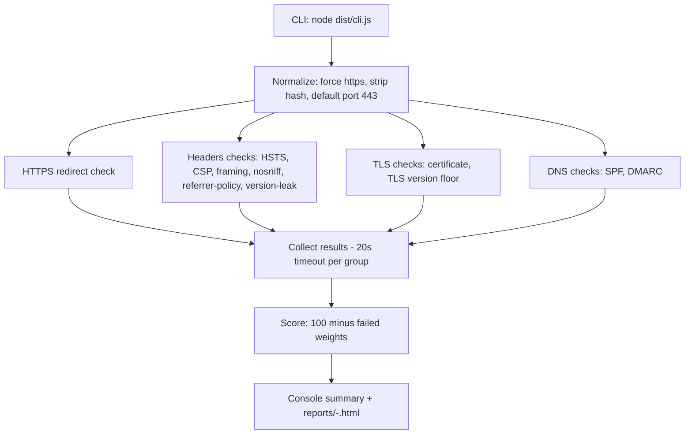

# SiteVitals — v1 (URL checker)

## What it is

SiteVitals is a fast, passive hygiene audit for any website. Give it a URL and it checks the security basics — HTTPS redirect, security headers (HSTS, CSP, framing, nosniff, referrer-policy, version leaks), TLS certificate and version, and DNS records (SPF, DMARC) — then scores the site out of 100 with a grade and a plain-English fix for every failure. Reports are self-contained HTML files: emailable, open offline, no dashboard needed.

## Why we need it

Most websites don't get hacked through exotic vulnerabilities — they fail on the basics: a missing HSTS header, a loose CSP, an expired certificate, no DMARC record. Those misconfigurations are cheap to fix but invisible until someone looks, and a full security audit is slow and expensive overkill for a routine check. SiteVitals covers the gap: a five-minute check you can run any time, on any site — before a launch, after a migration, or on a schedule.

## How it helps

- **One command, no setup** — `npm run check -- <url>` and you have a report.
- **A score you can track** — run it again after fixes and watch the grade move; the score makes "is the site healthier?" answerable.
- **Fixes, not just findings** — every failure ships with a plain-English fix snippet, so you (or your host/dev) know exactly what to change.
- **Safe to run anywhere** — all checks are passive reads (headers, cert, DNS). No scans, no payloads, nothing that touches the site.
- **Shareable output** — the HTML report works over email and offline, so it can go to a client, a host, or a portfolio.

SiteVitals is a hygiene check, not a full audit or penetration test — it won't find application vulnerabilities. It makes sure the front door is locked, the windows are latched, and the alarm is on.

## Run

```bash
npm run build        # compile TypeScript
node dist/cli.js <url>   # or: npm run check -- <url>
# example: npm run check -- https://example.com
```

Output: console summary + `reports/<host>-<timestamp>.html`.

## How a check runs

1. **Normalize** — the URL is forced to https, the hash stripped, the port defaulted to 443.
2. **Four check groups run in parallel** — nothing runs first; they all fire at once, each with a 20s timeout: HTTPS redirect; headers (HSTS, CSP, framing, nosniff, referrer-policy, version-leak); TLS (certificate, version floor); DNS (SPF, DMARC).
3. **Score** — 100 minus the weights of failed checks. A check that errors (timeout, DNS down) never counts as a vulnerability.
4. **Report** — console summary + self-contained HTML report in `reports/`.



## Checks (all passive — no scans, no payloads)

| id | name | weight |
|---|---|---|
| `https-redirect` | HTTP → HTTPS redirect | 10 |
| `hsts` | Strict-Transport-Security header | 12 |
| `csp` | Content-Security-Policy | 12 |
| `framing` | Clickjacking protection (X-Frame-Options / CSP frame-ancestors) | 8 |
| `nosniff` | X-Content-Type-Options: nosniff | 5 |
| `referrer-policy` | Referrer-Policy header | 3 |
| `version-leak` | Server/X-Powered-By version disclosure | 6 |
| `tls-cert` | Certificate validity + expiry | 12 |
| `tls-version` | TLS 1.2+ floor | 8 |
| `spf` | SPF TXT record | 7 |
| `dmarc` | DMARC TXT record (enforcing policy) | 7 |

Score = 100 − weights of failed checks. `error` means a check couldn't run
(timeout, DNS down) and never counts as a vulnerability. Every `fail` carries
a plain-English fix snippet in both the console output and the HTML report.

## Layout

- `src/checks/<id>.ts` — one file per check, filename = check id (see spec memory)
- `src/orchestrator.ts` — URL normalization, parallel runs, 20s timeouts
- `src/scorer.ts` — weights table (tune here, not in check logic)
- `src/report.ts` — self-contained HTML (inline CSS only)
- `src/cli.ts` — console summary + report file

## Acceptance (2026-10-17)

Test harness in `test-harness/`: two localhost servers — a hardened one and
a bare one (no headers, version-leaking Server banner). Results:

- Hardened server: **86/100 (Grade B)** — 8 passed, 2 failed (SPF/DMARC,
  honestly absent on localhost), 1 error (no plain-HTTP listener in harness).
- Bare server: **40/100 (Grade F)** — 8 failed, every finding with a fix.

Live-internet runs work on the user's own machine; the build VM's egress
policy blocks Node's `fetch`, so external targets can't be scanned from here.

## Next (v2)

Repo scanning (secrets, deps, injection) per the spec — ecosystem and
secrets-rule sources still open questions. JSON output flag still undecided.
