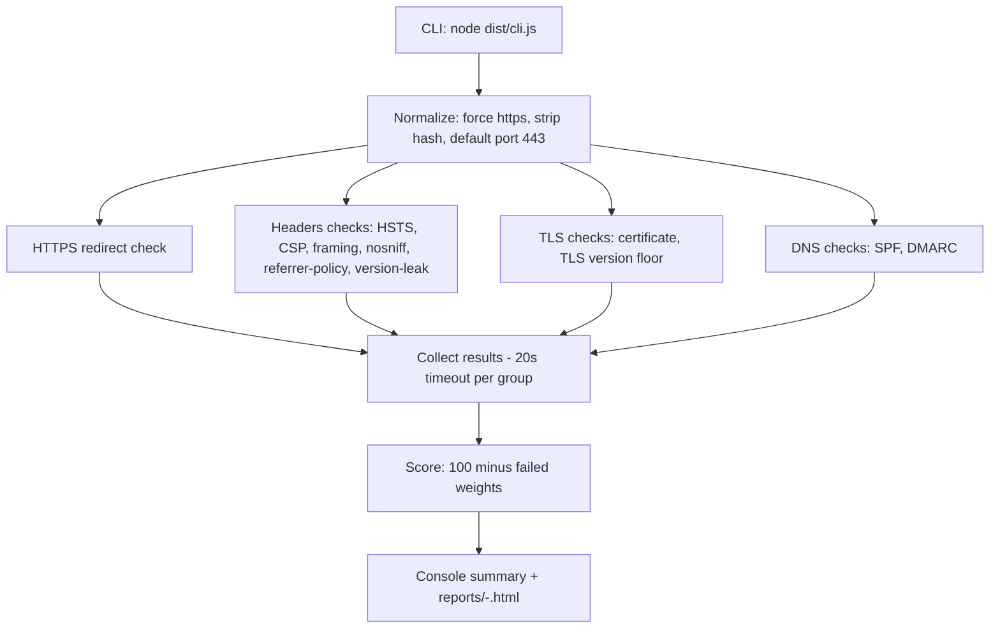

# SiteVitals — v1 (URL checker)

## What it is

SiteVitals is a fast, passive hygiene audit for any website. Give it a URL and it checks the security basics — HTTPS redirect, security headers (HSTS, CSP, framing, nosniff, referrer-policy, version leaks, cookie flags), TLS certificate and version, and DNS records (SPF, DMARC) — then scores the site out of 100 with a grade and a plain-English fix for every failure. Reports are self-contained HTML files: emailable, open offline, no dashboard needed.

## Why we need it

Most websites don't get hacked through exotic vulnerabilities — they fail on the basics: a missing HSTS header, a loose CSP, an expired certificate, no DMARC record. Those misconfigurations are cheap to fix but invisible until someone looks, and a full security audit is slow and expensive overkill for a routine check. SiteVitals covers the gap: a five-minute check you can run any time, on any site — before a launch, after a migration, or on a schedule.

## How it helps

- **One command, no setup** — `npm run check -- <url>` and you have a report.
- **A score you can track** — run it again after fixes and watch the grade move; the score makes "is the site healthier?" answerable.
- **Fixes, not just findings** — every failure ships with a plain-English fix snippet, so you (or your host/dev) know exactly what to change.
- **Safe to run anywhere** — all checks are passive reads (headers, cert, DNS). No scans, no payloads, nothing that touches the site.
- **Shareable output** — the HTML report works over email and offline, so it can go to a client, a host, or a portfolio.

SiteVitals is a hygiene check, not a full audit or penetration test — it won't find application vulnerabilities. It makes sure the front door is locked, the windows are latched, and the alarm is on.

## Run

```bash
npm run build        # compile TypeScript
node dist/cli.js <url>   # or: npm run check -- <url>
# example: npm run check -- https://example.com
```

Output: console summary + `reports/<host>-<timestamp>.html`.

## JSON output (v2)

Add `--json` and stdout is pure JSON — same score, grade, counts, and per-check results, plus the HTML report path — so other tools can consume a run without scraping the console summary:

```bash
node dist/cli.js https://example.com --json | jq '.score, .grade'
# or: npm run check -- https://example.com --json
```

## Example outputs

Sample reports generated from the test harness (`test-harness/serve.mjs`) on 2026-11-25 — open the HTML files in a browser to see the rendered report:

- `examples/localhost-hardened-8443.html` — hardened localhost site: **81/100 (Grade B)**. 14 passed, 3 failed (SPF/DMARC/CAA, honestly absent on localhost), 1 error (no plain-HTTP listener in the harness).
- `examples/localhost-bare-8080.html` — bare localhost site: **15/100 (Grade F)**. 3 passed, 14 failed, every finding with a plain-English fix.

To regenerate them: start the harness (`node test-harness/serve.mjs`), then run the checker against `https://localhost:8443` and `https://localhost:8080` with the harness certificate trusted (`NODE_EXTRA_CA_CERTS=test-harness/cert.pem`).

## How a check runs

1. **Normalize** — the URL is forced to https, the hash stripped, the port defaulted to 443.
2. **Four check groups run in parallel** — nothing runs first; they all fire at once, each with a 20s timeout: HTTPS redirect; headers (HSTS, CSP, framing, nosniff, referrer-policy, version-leak, cookie flags, Permissions-Policy, isolation headers, security.txt); TLS (certificate, version floor, expiry window); DNS (SPF, DMARC, CAA).
3. **Score** — 100 minus the weights of failed checks. A check that errors (timeout, DNS down) never counts as a vulnerability.
4. **Report** — console summary + self-contained HTML report in `reports/`.



## Checks (all passive — no scans, no payloads)

| id | name | weight |
|---|---|---|
| `https-redirect` | HTTP → HTTPS redirect | 10 |
| `hsts` | Strict-Transport-Security header | 12 |
| `hsts-preload` | HSTS preload eligibility (max-age ≥ 31536000 + includeSubDomains + preload; judged from the header, no external API) | 3 |
| `csp` | Content-Security-Policy | 12 |
| `framing` | Clickjacking protection (X-Frame-Options / CSP frame-ancestors) | 8 |
| `nosniff` | X-Content-Type-Options: nosniff | 5 |
| `referrer-policy` | Referrer-Policy header | 3 |
| `version-leak` | Server/X-Powered-By version disclosure | 6 |
| `cookie-flags` | Secure, HttpOnly, SameSite on every Set-Cookie (pass if no cookies are set) | 6 |
| `permissions-policy` | Permissions-Policy header present | 3 |
| `isolation-headers` | Cross-Origin-Opener-Policy present (COEP/CORP reported as info, not scored) | 5 |
| `security-txt` | security.txt served at /.well-known/security.txt (2xx) | 3 |
| `tls-cert` | Certificate validity + expiry | 12 |
| `tls-version` | TLS 1.2+ floor | 8 |
| `cert-expiry-window` | Leaf cert expires within 30 days (in addition to validity) | 8 |
| `spf` | SPF TXT record | 7 |
| `dmarc` | DMARC TXT record (enforcing policy) | 7 |
| `caa` | CAA record (which CAs may issue for the domain) | 5 |

Score = 100 − weights of failed checks. `error` means a check couldn't run
(timeout, DNS down) and never counts as a vulnerability. Every `fail` carries
a plain-English fix snippet in both the console output and the HTML report.

## Layout

- `src/checks/` — four grouped files, NOT one file per check id:
  `dns.ts` (SPF, DMARC, CAA), `headers.ts` (HSTS, CSP, framing, nosniff,
  referrer-policy, version-leak, cookie flags, Permissions-Policy,
  isolation headers, security.txt), `https.ts` (HTTP → HTTPS redirect,
  HSTS, HSTS preload), `tls.ts` (certificate, TLS version, expiry window)
- `src/orchestrator.ts` — URL normalization, parallel runs, 20s timeouts
- `src/scorer.ts` — weights table (tune here, not in check logic)
- `src/report.ts` — self-contained HTML (inline CSS only)
- `src/cli.ts` — console summary + report file; dispatches `repo` to the
  repo scanner
- `src/repo/` — repo scanning (`repo` subcommand): `scanner.ts` (tree
  walk + caps), `orchestrator.ts` (check modules), `scorer.ts` (repo
  weights), `report.ts` (repo HTML report), `allowlist.ts`
  (`.sitevitals-allowlist.json`), `checks/` (one module per area:
  secrets, deps, injection)

## Acceptance (2026-10-17)

Test harness in `test-harness/`: two localhost servers — a hardened one and
a bare one (no headers, version-leaking Server banner). Results:

- Hardened server: **81/100 (Grade B)** — 14 passed, 3 failed (SPF/DMARC/
  CAA, honestly absent on localhost — DNS records cannot be published for
  `localhost`), 1 error (no plain-HTTP listener in harness). Both targets
  pass `cert-expiry-window`: the harness cert is valid until Oct 2027, so
  the fail path is verified separately with a throwaway 5-day cert (see
  below) rather than by the harness.
- Bare server: **15/100 (Grade F)** — 14 failed (the previous 13 plus
  `hsts-preload`: no HSTS header at all), every finding with a fix.

Fail-path check for `cert-expiry-window` (throwaway, not in the harness):
generate a 5-day cert, serve it from a scratch server, and scan it with
that cert trusted — `tls-cert` passes (the cert is valid) while
`cert-expiry-window` fails:

```bash
mkdir /tmp/sv-shortcert && cd /tmp/sv-shortcert
openssl req -x509 -newkey rsa:2048 -keyout key.pem -out cert.pem -days 5 \
  -nodes -subj "/CN=localhost" -addext "subjectAltName=DNS:localhost,IP:127.0.0.1"
node -e "require('node:https').createServer({key:require('node:fs').readFileSync('key.pem'),cert:require('node:fs').readFileSync('cert.pem')},(_,res)=>{res.writeHead(200);res.end('ok')}).listen(18443)"
NODE_EXTRA_CA_CERTS=/tmp/sv-shortcert/cert.pem node dist/cli.js https://localhost:18443 --json | jq '.results[] | select(.id=="cert-expiry-window")'
# → status "fail", "expires in 5 days … inside the 30-day renewal window"
```

Re-run from this VM on 2026-10-26 reproduced both scores exactly.

Live-internet runs are cleanest on your own machine: from this VM, plain fetch works through the proxy but the direct TLS check errors on external targets, so external scores from here carry that artifact.

## Repo scanning (v2)

`sitevitals repo <path>` audits a local working tree — secrets, vulnerable
npm dependencies, and JS/TS injection patterns — with its own 100-point
score that reuses the URL scorer/report/`--json` machinery. The v1 URL
score is untouched.

```bash
node dist/cli.js repo ./my-project --json | jq '.score, .grade'
```

- **Report-only** — it never changes the scanned repo, never auto-fixes,
  never commits. Findings are read-only output.
- **Working tree only** — git-history scanning is deferred, not built.
- **Local path only** — no GitHub URL cloning in this slice.
- **Secrets are never printed** — findings carry rule id + file + line +
  redacted preview only. Found secrets are never verified live, no
  exceptions.
- **Secrets rules** — vendored Gitleaks default rules (MIT, attributed in
  `src/repo/rules/secrets.json`): a curated subset of the Gitleaks
  default config (AWS, GitHub, GitLab, Slack, Stripe, private keys,
  generic API keys/passwords, JWT, npm, SendGrid), hand-written from the
  known default rule set — no live fetch was available in this sandbox,
  and no Gitleaks code is used, patterns only. No shell-outs to
  gitleaks/semgrep; the engine is in-house. Extra rules, same source and
  same redaction, added one PR per check: Azure storage key, Google API
  key, GCP service-account key file, Twilio API key, OpenAI API key,
  database connection string (postgres/mysql/mongodb URI with embedded
  credentials).
- **Caps** — max 5,000 files, 1 MiB per file; `node_modules/.git/dist`
  skipped; OSV failure is an `error`, not a `fail`.
- **Allowlist** — a `.sitevitals-allowlist.json` in the scanned root
  suppresses findings for a file (or one rule in a file), with a reason
  per entry. The repo's own allowlist covers the test-harness TLS key
  and the planted fixture secrets.
- **Deps (npm first)** — `package-lock.json` is parsed and the packages
  are checked against the OSV.dev API (free, no key), in two steps because
  that is how OSV works: `POST /v1/querybatch` returns only minimal vuln
  records, and the full record (aliases, severity, fixed versions) comes
  from `GET /v1/vulns/<id>`. Only package names + versions leave the
  machine — never code. Python next, same flow: `requirements.txt`
  (pinned `==` versions only — unpinned lines are skipped, not findings)
  and `Pipfile.lock` (`default` + `develop`, pinned `==` only), queried
  as PyPI. Query order is deterministic: npm (sorted by name), then
  PyPI (sorted by name); one finding per vulnerable package
  (`deps-vulnerable`, 12). Go next, same flow: `go.mod` `require`
  blocks and single-line requires (module path + `vX.Y.Z`, the `v`
  prefix is what OSV expects), queried as Go. Query order is npm,
  then PyPI, then Go, each sorted by name. OSV returns Go `fixed`
  versions without the `v` prefix; the fix guidance re-adds it
  (`go get` needs `v1.9.1`, not `1.9.1`). `--osv-fixture <file>` runs the deps check against
  recorded responses instead of the network (how it is verified offline;
  the live API was verified reachable from this VM on 2026-11-24).
  The fixture is a wrapper holding both recorded steps
  (`{querybatch, details}`):
  `test-harness/fixtures/osv-lodash-vulnerable-response.json` (lodash
  4.17.11 → GHSA-35jh-r3h4-6jhm / CVE-2021-23337, Command Injection,
  fixed 4.17.21, and GHSA-p6mc-m468-83gw / CVE-2020-8203, Prototype
  Pollution, fixed 4.17.20) and `osv-lodash-clean-response.json` (a
  recorded no-vulns snapshot for lodash 4.17.21, exercising the clean
  path). The combined fixtures cover npm + PyPI together and are the
  ones the dirty/clean fixture runs use:
  `osv-dirty-combined-response.json` (lodash 4.17.11 + flask 2.0.1 +
  idna 3.7 + gin v1.7.4) and `osv-clean-combined-response.json` (lodash 4.17.21 +
  click 8.1.7 + uuid v1.6.0, snapshot no-vulns). Flask 2.0.1 records 4 OSV ids
  covering 2 CVEs (CVE-2023-30861 session-cookie Vary header, fix
  2.3.2; CVE-2026-27205, fix 3.1.3 — highest fixed version across the
  package is 3.1.3); idna 3.7 records 2 ids for 1 CVE (CVE-2026-45409,
  fix 3.15); gin v1.7.4 records 5 OSV ids covering 3 issues
  (CVE-2020-28483 request smuggling, fix 1.7.7; CVE-2023-26125 input
  validation, fix 1.9.0; CVE-2023-29401 filename handling, fix 1.9.1 —
  highest fixed version across the package is 1.9.1, shown as v1.9.1). Provenance, stated plainly: both are hand-recorded from live
  OSV responses fetched 2026-11-24 — the GHSA/CVE ids, summaries, and
  fixed versions are verbatim from OSV; the files are static stand-ins
  for the network responses. (Live OSV currently lists 6 vulns for
  lodash 4.17.11; the fixture records the two this slice is verified
  against. The brief's original pairing was wrong — GHSA-35jh is
  CVE-2021-23337, not CVE-2019-10744, which belongs to
  GHSA-jf85-cpcp-j695 — and the fixture was corrected to live OSV data
  on 2026-11-24.) The clean snapshot is also a point in time: live OSV
  has since listed newer vulns for lodash 4.17.21
  (GHSA-xxjr-mmjv-4gpg, GHSA-r5fr-rjxr-66jc), so the clean fixture
  tests the clean code path, not current live data. Fix guidance
  takes the highest fixed version across a package's vulns, and only when
  every listed vuln has a published fix (4.17.21 for lodash 4.17.11 — it
  fixes both listed vulns). Fix versions that are not version-shaped
  (some records list a commit SHA as "fixed") are ignored when picking
  the highest fix. OSV failure is an `error`, never a `fail`.
- **Injection (JS/TS)** — hand-written regex patterns (dynamic code
  execution, shell commands built from input, SQL string building,
  unsanitized HTML assignment). No semgrep/opengrep shell-outs; AST/taint
  is a later upgrade path.
- **Dockerfile** — `Dockerfile` / `Dockerfile.*` files: runs as root
  (no `USER`, or `USER root`), secrets in `ENV`/`ARG` layers (judged by
  the same vendored secrets rules, same redaction), unpinned base image
  (`:latest` or no tag — a registry `:port` is not a tag, a digest pin
  counts as pinned). One finding per issue; a secret in a layer is
  flagged by both this module and the secrets module.
- **Fixtures** — `test-harness/fixtures/clean/` (expected 100/100) and
  `test-harness/fixtures/dirty/` (planted secrets, a vulnerable lodash,
  every injection pattern; all fake values, never real credentials).

### Legal 6 / agent guardrails — repo slice

The legal 6 (self-hosted fonts, no session replay, age screen, CAN-SPAM
footer, subscription renewal terms, DMCA agent) are mostly N/A for a
local CLI with no fonts, no tracking, no signup, no email and no uploads
— they bite in the web UI slice, not here. The 5 agent guardrails apply:
scored outputs (separate 100-point repo score), a corrective-action path
(every finding carries a fix), a human-in-the-loop gate for destructive
steps (there are none — report-only), emergency stop / iteration caps
(file/size caps, OSV timeout), and loud input validation (a missing or
non-directory path is a hard error) plus secret/PII output checks
(redacted previews, allowlist).

## Next (v2)

- JSON output flag: DONE in this PR (`--json`, pure JSON on stdout).
- Repo scanning (secrets, deps, injection) — scaffold in this PR; secrets,
  deps and injection land one slice each, npm first. Git-history scanning
  and Python/PyPI are deferred. Secrets rules are vendored Gitleaks
  defaults (MIT, attributed).
- Web UI — later PR, after repo scanning.
